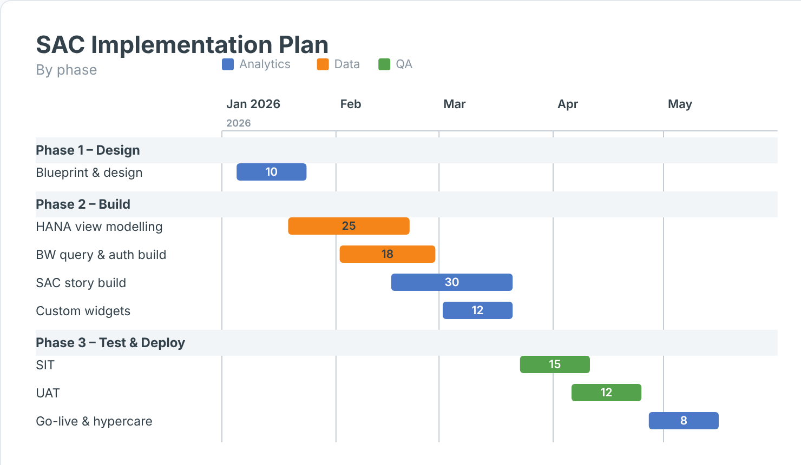

# DataCo-Public

Content created by **[The Data Co](https://thedataco.co.za)** across Data, Analytics & AI workflows,
mainly **SAP Analytics Cloud (SAC) custom widgets**. Each widget is self-contained: it renders
pure SVG, needs no CDN or external libraries, and can be installed in any SAC tenant with
one JSON manifest and one ZIP bundle.

## SAC custom widgets

| Widget | Version | What it shows | Folder |
|---|---|---|---|
| **Variance KPI Tile** | 0.1.0 | Headline Actual with ▲/▼ variance vs Plan and Prior Year, plus a sparkline | [`SAC/Variance KPI Tile`](SAC/Variance%20KPI%20Tile) |
| **Variance Bridge** | 0.1.0 | Plan → Actual waterfall by driver, with Top‑N + Other | [`SAC/Variance Bridge`](SAC/Variance%20Bridge) |
| **Bullet Chart** | 0.1.0 | Actual vs Target with % of target bands and a Forecast marker | [`SAC/Bullet Chart`](SAC/Bullet%20Chart) |
| **Variance Heatmap** | 0.1.0 | Row × column variance % with RAG or diverging colour and totals | [`SAC/Variance Heatmap`](SAC/Variance%20Heatmap) |
| **Calendar Heatmap** | 0.2.0 | Daily values on a calendar grid (Gregorian or 4‑4‑5 retail) | [`SAC/Calendar Heatmap`](SAC/Calendar%20Heatmap) |
| **Order Flow Funnel** | 0.3.0 | Process‑flow funnel with stage conversion | [`SAC/Flow Diagram`](SAC/Flow%20Diagram) |
| **Gantt Chart** | 0.1.1 | Timeline bars from start/end dates with swimlanes | [`SAC/ganttChart_1.json`](SAC/ganttChart_1.json) |

Screenshots of every widget are in the [gallery](#widget-gallery) below, and each widget folder has its own README with its data
model and properties.

## Widget gallery

### Variance KPI Tile


### Variance Bridge


### Bullet Chart


### Variance Heatmap


### Calendar Heatmap


### Order Flow Funnel


### Gantt Chart


## Variance pack

The four variance widgets are built to be used together on management dashboards, and they share
the same conventions:

- **Measures are bound in order, with Actual first**, followed by Plan/Target, then Prior Year or Forecast.
- **`invertSign`** is for cost measures: when it is on, coming in under plan shows green.
- The **number format** is the same in all four: `valueScale` (auto/K/M/B), `decimals`, `prefix`, `suffix`.
- Hierarchy **total nodes are skipped**, so totals are not counted twice.

## Install a widget in SAC

1. Download the widget's `<name>.json` and `<name>.zip` from its folder.
2. In SAC, go to **Administration → App Integration → Custom Widgets → Add**.
3. Upload the **JSON** into the manifest slot and the **ZIP** into the resource slot.
4. In a story or analytic application, choose **Insert → Custom Widgets**, add the widget, and bind
   the dimensions and measures in the Builder panel. Use the Styling panel for labels, colours and thresholds.

All widgets have `supportsExport: true`, so they appear in PDF/PPT exports.

## Folder layout

```
SAC/<Widget>/
  <name>.json          manifest (upload to SAC)
  <name>.zip           JS bundle (upload to SAC)
  <name>.js            main web component (renderer inlined)
  <name>Styling.js     Builder / styling panel
  renderer.core.js     pure renderer, shared with the preview
  preview.html         local sandbox with synthetic data (open in a browser)
  README.md            data model, properties, notes
  Example.png          screenshot
```

## Preview locally

Open any `preview.html` in a browser; it doesn't need a server or a SAC tenant. It runs the same
renderer as the widget on synthetic data, with controls for the main options.

## Notes and limitations

- The widgets work with SAC data bindings on both live (BW/HANA) and import models. On live BW,
  keep variance, YTD and restricted key figure logic in the query or HANA view, and use the
  widgets for presentation.
- In the manifests, `ignoreIntegrity` is `true`, which is fine for development. For production
  tenants that enforce integrity, set it to `false` and keep the `integrity` hashes in step with
  the JS files.
- The widgets are provided as is. Test them on your own models before using them in production.

## Contact

The Data Co (Pty) Ltd · Century City, Cape Town · [thedataco.co.za](https://thedataco.co.za) · admin@thedataco.co.za
SAP Analytics (BW, Datasphere, SAC, HANA Cloud) · SAP ABAP/Fiori · SAP GRC
