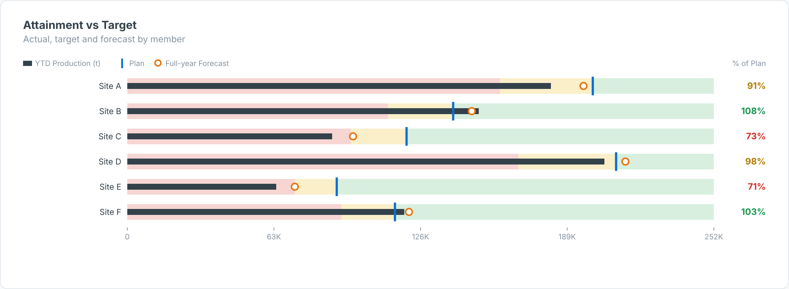

# Bullet Chart — SAC Custom Widget (v0.1.0)

A **bullet chart** for SAP Analytics Cloud (Stephen Few style): one row per member with
qualitative bands as **% of target**, the **Actual** bar, a **Target** tick, an optional
**Forecast** marker, and an attainment % column coloured green / amber / red.

Part of the Data Co **variance pack** (KPI Tile, Variance Bridge, Bullet Chart, Variance
Heatmap). Same conventions across all four: measures are bound **in order** (Actual first),
`invertSign` for cost measures, and shared number formatting. Self-contained SVG, no CDN.

## Files

| File | Purpose |
|------|---------|
| `bulletChart.json` | Manifest — upload as the **JSON** in SAC. |
| `bulletChart.zip` | JS bundle — upload as the **ZIP** in SAC. |
| `bulletChart.js` | Main web component (renderer inlined). |
| `bulletChartStyling.js` | Builder panel. |
| `renderer.core.js` | Canonical renderer, shared with the preview. |
| `preview.html` | Sandbox with synthetic data + controls (open locally in a browser). |

## Data model

- **Dimension:** the member (site, region, product…).
- **Measures (in order):** 1 = Actual, 2 = Target/Plan, 3 = Forecast (optional).

Hierarchy result/total nodes (`isTotal`) are skipped so they are not double-counted. For live
BW/HANA models, put variance and YTD logic in the query/view; the widget only does
presentation-level variance.

## Deploy (JSON + ZIP)

**Administration → App Integration → Custom Widgets → Add**, upload `bulletChart.json` (JSON slot)
and `bulletChart.zip` (ZIP slot), then insert the widget in a story/application and bind the feeds
in the Builder. `supportsExport` is `true`, so it is included in PDF/PPT export.

## Key properties

| Property | Default | Notes |
|----------|---------|-------|
| `title` / `subtitle` | | Labels. |
| `bandLow / bandHigh` | 80 / 100 | Band cut-offs as % of target (poor < low ≤ ok < high ≤ good). |
| `invertSign` | false | Cost measures: under target = good; bands flip. |
| `sortBy` | none | `none`, `attainment`, `actual`. |
| `scaleMode` | shared | `shared` axis across rows, or `perRow`. |
| `rowHeight / labelWidth` | 34 / 140 | Layout in px. |
| colour properties | | All exposed in the Styling panel. |

## Licence

Proprietary. Copyright © 2026 The Data Co (Pty) Ltd. All rights reserved. This widget may be installed
and used only under a written licence or services agreement with The Data Co; copying, modification and
redistribution are prohibited. See the repository [LICENSE](../../LICENSE).
