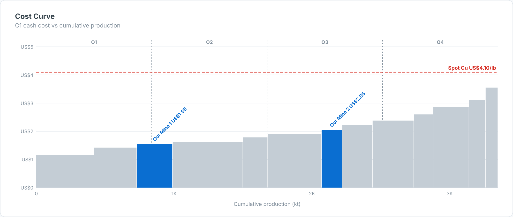

# Cost Curve — SAC Custom Widget (v0.1.0)

An **industry cost curve**: operations sorted by unit cost, with bar **width = production**
and **height = cost** on a cumulative-production axis. Your own assets are highlighted, with
**quartile** markers and an optional **price line** (e.g. spot copper).

Part of the Data Co **mining pack** (Mine-to-Mill Sankey, Grade-Tonnage Curve, Recovery vs Head
Grade, Metal Balance, OEE Time Usage, Fleet Status Timeline, Cost Curve, Safety Pyramid).
Self-contained SVG, no CDN. Units default to copper (t, % Cu, US$/lb); change them in the Styling panel.

## Files

| File | Purpose |
|------|---------|
| `costCurve.json` | Manifest — upload as the **JSON** in SAC. |
| `costCurve.zip` | JS bundle — upload as the **ZIP** in SAC. |
| `costCurve.js` | Main web component (renderer inlined). |
| `costCurveStyling.js` | Builder panel. |
| `renderer.core.js` | Canonical renderer, shared with the preview. |
| `preview.html` | Sandbox with synthetic data + controls (open locally in a browser). |

## Data model

- **Dimensions (in order):** 1 = Operation, 2 = Owner/group (optional).
- **Measures (in order):** 1 = Production, 2 = Unit cost (C1, AISC…). Cost is production-weighted when aggregated.

## Deploy (JSON + ZIP)

**Administration → App Integration → Custom Widgets → Add**, upload `costCurve.json` (JSON slot)
and `costCurve.zip` (ZIP slot), then insert the widget and bind the feeds in the Builder.
`supportsExport` is `true`.

## Key properties

| Property | Default | Notes |
|----------|---------|-------|
| `title` / `subtitle` | | Labels. |
| `highlight` | (blank) | Comma list of operations to highlight. |
| `highlightGroup` | (blank) | Highlight every operation whose owner matches. |
| `price / priceLabel` | 0 / Price | Price line (0 = off). |
| `costPrefix / costSuffix` | US$ / /lb | Cost formatting. |
| colour properties | | All exposed in the Styling panel. |

Sample data in `preview.html` and `Example.png` is synthetic.
