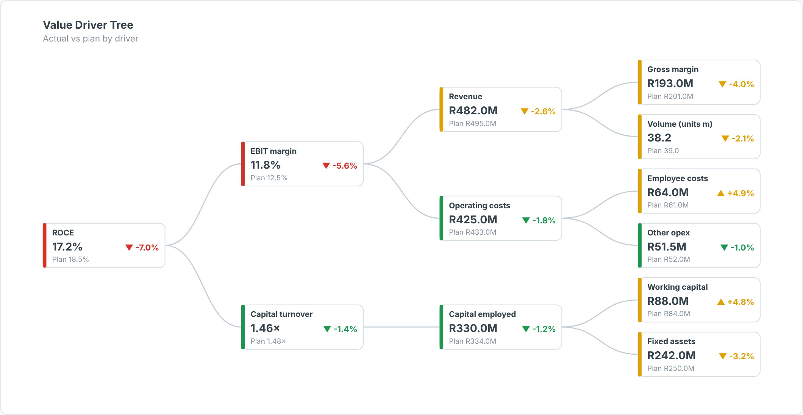

# Driver Tree — SAC Custom Widget (v0.1.0)

A **value driver tree**: e.g. ROCE → EBIT margin × capital turnover → revenue, costs, capital
employed → … laid out left to right. Each node shows **actual, plan and variance %** with a RAG
bar; cost drivers can be flagged as *lower is better*.

Area: **EXCO** · Self-contained SVG, no CDN · Currency switch ZAR / USD where amounts are shown.

## Files

| File | Purpose |
|------|---------|
| `driverTree.json` | Manifest — upload as the **JSON** in SAC. |
| `driverTree.zip` | JS bundle — upload as the **ZIP** in SAC. |
| `driverTree.js` | Main web component (renderer inlined). |
| `driverTreeStyling.js` | Builder panel. |
| `renderer.core.js` | Canonical renderer, shared with the preview. |
| `preview.html` | Sandbox with synthetic data + controls (open locally in a browser). |

## Data model

- **Dimensions (in order):** 1 Node (driver name), 2 Parent node. Root: blank, `#` or *Not assigned*.
  A parent-child hierarchy or a flat mapping table works.
- **Measures (in order):** 1 Actual, 2 Plan.
- `nodeFormats` sets per-node formats (`pct`, `ratio`, `number`; default currency), e.g.
  `ROCE:pct,Capital turnover:ratio`.

Hierarchy result/total nodes (`isTotal`) are skipped so they are not double-counted.

## Deploy (JSON + ZIP)

**Administration → App Integration → Custom Widgets → Add**, upload `driverTree.json` (JSON slot) and
`driverTree.zip` (ZIP slot), then insert the widget and bind the feeds in the Builder. `supportsExport` is `true`.

## Key properties

| Property | Default | Notes |
|----------|---------|-------|
| `title` / `subtitle` | | Labels. |
| `nodeFormats` | (blank) | Per-node number format. |
| `lowerIsBetter` | (blank) | Comma list of cost-type nodes. |
| `tolerance / warnTolerance` | 2 / 5 | % bands for green / amber. |
| `currency` | ZAR | `ZAR` (R), `USD` ($) or `custom`. |
| colour properties | | All exposed in the Styling panel. |

Sample data in `preview.html` and `Example.png` is synthetic.

## Licence

Proprietary. Copyright © 2026 The Data Co (Pty) Ltd. All rights reserved. This widget may be installed
and used only under a written licence or services agreement with The Data Co; copying, modification and
redistribution are prohibited. See the repository [LICENSE](../../../LICENSE).
