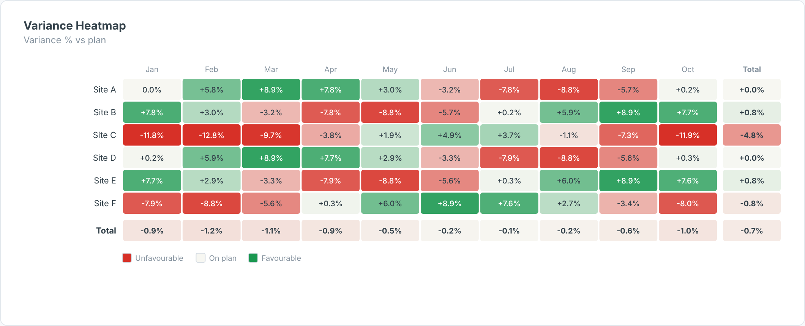

# Variance Heatmap — SAC Custom Widget (v0.1.0)

A **row × column variance heatmap** for SAP Analytics Cloud — e.g. Site × Month —
coloured by **variance % vs plan** (or absolute variance) on a diverging scale or with
**RAG thresholds**, with row, column and grand totals. With only one measure bound it
falls back to a plain value heatmap.

Part of the Data Co **variance pack** (KPI Tile, Variance Bridge, Bullet Chart, Variance
Heatmap). Same conventions across all four: measures are bound **in order** (Actual first),
`invertSign` for cost measures, and shared number formatting. Self-contained SVG, no CDN.

## Files

| File | Purpose |
|------|---------|
| `varianceHeatmap.json` | Manifest — upload as the **JSON** in SAC. |
| `varianceHeatmap.zip` | JS bundle — upload as the **ZIP** in SAC. |
| `varianceHeatmap.js` | Main web component (renderer inlined). |
| `varianceHeatmapStyling.js` | Builder panel. |
| `renderer.core.js` | Canonical renderer, shared with the preview. |
| `preview.html` | Sandbox with synthetic data + controls (open locally in a browser). |

## Data model

- **Dimensions (in order):** 1 = Rows, 2 = Columns. (One dimension → a single column.)
- **Measures (in order):** 1 = Actual, 2 = Plan (optional).

Totals are recomputed from summed Actual and Plan (variance of totals, not a sum of %).

Hierarchy result/total nodes (`isTotal`) are skipped so they are not double-counted. For live
BW/HANA models, put variance and YTD logic in the query/view; the widget only does
presentation-level variance.

## Deploy (JSON + ZIP)

**Administration → App Integration → Custom Widgets → Add**, upload `varianceHeatmap.json` (JSON slot)
and `varianceHeatmap.zip` (ZIP slot), then insert the widget in a story/application and bind the feeds
in the Builder. `supportsExport` is `true`, so it is included in PDF/PPT export.

## Key properties

| Property | Default | Notes |
|----------|---------|-------|
| `title` / `subtitle` | | Labels. |
| `mode` | variancePct | `variancePct`, `varianceAbs`, or `value`. |
| `colorMode` | continuous | `continuous` (diverging) or `rag`. |
| `thresholdBad / thresholdGood` | -5 / 5 | % cut-offs for RAG; continuous saturates at 2×. |
| `invertSign` | false | Cost measures: below plan = favourable. |
| `showValues / showTotals` | true | Toggles. |
| `cellHeight / labelWidth` | 30 / 130 | Layout in px. |
| colour properties | | All exposed in the Styling panel. |

## Licence

Proprietary. Copyright © 2026 The Data Co (Pty) Ltd. All rights reserved. This widget may be installed
and used only under a written licence or services agreement with The Data Co; copying, modification and
redistribution are prohibited. See the repository [LICENSE](../../../LICENSE).
