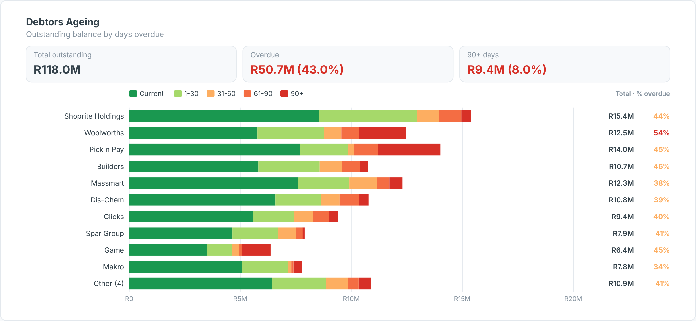

# Ageing Buckets (AR/AP) — SAC Custom Widget (v0.1.0)

**Debtors (AR) or creditors (AP) ageing**: stacked bars per customer or vendor across ageing buckets,
Top-N plus *Other*, sorted by overdue balance, with tiles for total outstanding, overdue and the oldest bucket.

Area: **Finance** · Self-contained SVG, no CDN · Currency switch ZAR / USD where amounts are shown.

## Files

| File | Purpose |
|------|---------|
| `ageingBuckets.json` | Manifest — upload as the **JSON** in SAC. |
| `ageingBuckets.zip` | JS bundle — upload as the **ZIP** in SAC. |
| `ageingBuckets.js` | Main web component (renderer inlined). |
| `ageingBucketsStyling.js` | Builder panel. |
| `renderer.core.js` | Canonical renderer, shared with the preview. |
| `preview.html` | Sandbox with synthetic data + controls (open locally in a browser). |

## Data model

- **Dimension:** customer / vendor.
- **Measures:** ageing buckets in order, current first (e.g. Current, 1-30, 31-60, 61-90, 90+). Bucket
  names come from the measure names. `currentBuckets` sets how many leading buckets are *not overdue*.

Hierarchy result/total nodes (`isTotal`) are skipped so they are not double-counted.

## Deploy (JSON + ZIP)

**Administration → App Integration → Custom Widgets → Add**, upload `ageingBuckets.json` (JSON slot) and
`ageingBuckets.zip` (ZIP slot), then insert the widget and bind the feeds in the Builder. `supportsExport` is `true`.

## Key properties

| Property | Default | Notes |
|----------|---------|-------|
| `title` / `subtitle` | | Labels. |
| `topN` | 10 | Rows before *Other*. |
| `sortBy` | overdue | `overdue`, `total`, `name`. |
| `currentBuckets` | 1 | Not-overdue buckets. |
| `currency` | ZAR | `ZAR` (R), `USD` ($) or `custom`. |
| colour properties | | All exposed in the Styling panel. |

Sample data in `preview.html` and `Example.png` is synthetic.

## Licence

Proprietary. Copyright © 2026 The Data Co (Pty) Ltd. All rights reserved. This widget may be installed
and used only under a written licence or services agreement with The Data Co; copying, modification and
redistribution are prohibited. See the repository [LICENSE](../../../LICENSE).
