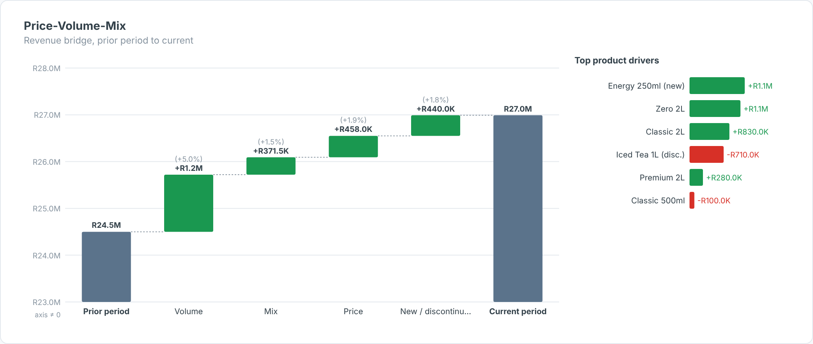

# Price-Volume-Mix Bridge — SAC Custom Widget (v0.1.0)

A **price-volume-mix bridge**: prior-period revenue to current revenue, split per product into
**Volume**, **Mix**, **Price** and **New / discontinued** effects, with a panel of the top product drivers.

Area: **Finance** · Self-contained SVG, no CDN · Currency switch ZAR / USD where amounts are shown.

## Files

| File | Purpose |
|------|---------|
| `pvmBridge.json` | Manifest — upload as the **JSON** in SAC. |
| `pvmBridge.zip` | JS bundle — upload as the **ZIP** in SAC. |
| `pvmBridge.js` | Main web component (renderer inlined). |
| `pvmBridgeStyling.js` | Builder panel. |
| `renderer.core.js` | Canonical renderer, shared with the preview. |
| `preview.html` | Sandbox with synthetic data + controls (open locally in a browser). |

## Data model

- **Dimension:** product / SKU / customer (the level at which price and mix are measured).
- **Measures (in order):** 1 Units PY, 2 Revenue PY, 3 Units CY, 4 Revenue CY.

Formulas (continuing products): Volume = (ΣUc − ΣUp) × avg price PY; Mix = Σ Uc·Pp − ΣUc × avg price PY;
Price = Σ Uc·(Pc − Pp). Products only in one period go to *New / discontinued*. The effects add up exactly
to the revenue change. Margin PVM works the same way if you bind margin instead of revenue.

Hierarchy result/total nodes (`isTotal`) are skipped so they are not double-counted.

## Deploy (JSON + ZIP)

**Administration → App Integration → Custom Widgets → Add**, upload `pvmBridge.json` (JSON slot) and
`pvmBridge.zip` (ZIP slot), then insert the widget and bind the feeds in the Builder. `supportsExport` is `true`.

## Key properties

| Property | Default | Notes |
|----------|---------|-------|
| `title` / `subtitle` | | Labels. |
| `showDrivers / topDrivers` | true / 6 | Product drivers panel. |
| `priorLabel / currentLabel` | Prior period / Current period | Bar labels. |
| `currency` | ZAR | `ZAR` (R), `USD` ($) or `custom`. |
| colour properties | | All exposed in the Styling panel. |

Sample data in `preview.html` and `Example.png` is synthetic.

## Licence

Proprietary. Copyright © 2026 The Data Co (Pty) Ltd. All rights reserved. This widget may be installed
and used only under a written licence or services agreement with The Data Co; copying, modification and
redistribution are prohibited. See the repository [LICENSE](../../../LICENSE).
