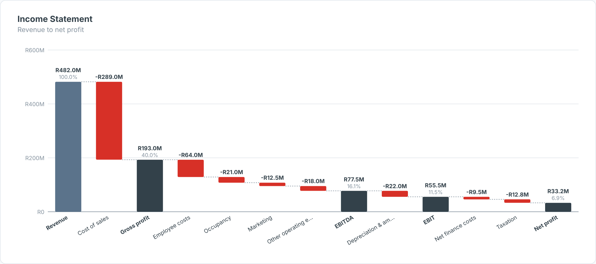

# P&L Waterfall — SAC Custom Widget (v0.1.0)

An **income-statement waterfall**: revenue stepped down through cost lines to net profit, with
**sub-total bars** (Gross profit, EBITDA, EBIT, Net profit) drawn from the running total, and
**% of revenue** under every total.

Area: **Finance** · Self-contained SVG, no CDN · Currency switch ZAR / USD where amounts are shown.

## Files

| File | Purpose |
|------|---------|
| `pnlWaterfall.json` | Manifest — upload as the **JSON** in SAC. |
| `pnlWaterfall.zip` | JS bundle — upload as the **ZIP** in SAC. |
| `pnlWaterfall.js` | Main web component (renderer inlined). |
| `pnlWaterfallStyling.js` | Builder panel. |
| `renderer.core.js` | Canonical renderer, shared with the preview. |
| `preview.html` | Sandbox with synthetic data + controls (open locally in a browser). |

## Data model

- **Dimension:** P&L line / account hierarchy node, in statement order (sort the dimension in the story).
- **Measure:** Amount.
- Members listed in `totalLines` are treated as sub-totals (their own values are ignored and recomputed).
  Use `insertTotals` (`Name@AfterLine`) to add sub-totals the model doesn't have.
- `costSign = positive` (default): costs stored as positive numbers are subtracted; the first line and
  any `revenueLines` are added. Use `negative` when costs are already negative in the model (typical BW sign).

Hierarchy result/total nodes (`isTotal`) are skipped so they are not double-counted.

## Deploy (JSON + ZIP)

**Administration → App Integration → Custom Widgets → Add**, upload `pnlWaterfall.json` (JSON slot) and
`pnlWaterfall.zip` (ZIP slot), then insert the widget and bind the feeds in the Builder. `supportsExport` is `true`.

## Key properties

| Property | Default | Notes |
|----------|---------|-------|
| `title` / `subtitle` | | Labels. |
| `costSign` | positive | `positive` or `negative`. |
| `totalLines` | Gross profit,EBITDA,EBIT,Profit before tax,Net profit | Sub-total members. |
| `insertTotals` | (blank) | e.g. `Gross profit@Cost of sales`. |
| `currency` | ZAR | `ZAR` (R), `USD` ($) or `custom` (`currencySymbol`). |
| colour properties | | All exposed in the Styling panel. |

Sample data in `preview.html` and `Example.png` is synthetic.

## Licence

Proprietary. Copyright © 2026 The Data Co (Pty) Ltd. All rights reserved. This widget may be installed
and used only under a written licence or services agreement with The Data Co; copying, modification and
redistribution are prohibited. See the repository [LICENSE](../../../LICENSE).
