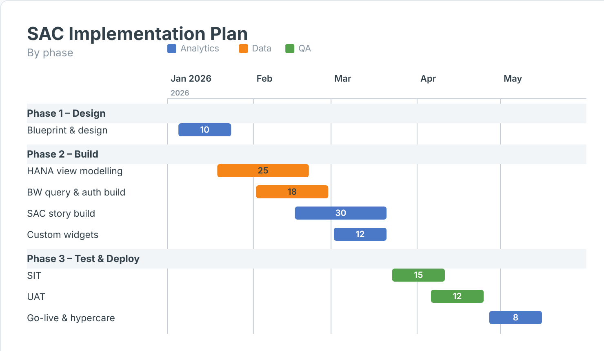

# Gantt Chart — SAC Custom Widget (v0.1.1)

Timeline Gantt: one bar per item from a start and end date, optional group swimlanes, categorical colour, a value label per bar, and a day/week/month axis with a 'today' rule.

Area: **General** · Self-contained SVG, no CDN.

## Files

| File | Purpose |
|------|---------|
| `ganttChart_1.json` | Manifest — upload as the **JSON** in SAC. |
| `ganttChart_1.zip` | JS bundle (`ganttChart.js`, `ganttChartStyling.js`) — upload as the **ZIP** in SAC. |

## Data model (named feeds)

| Feed | Content |
|---|---|
| label | Task label |
| startDate | Start date |
| endDate | End date |
| groupDim | Group (optional) |
| colorDim | Colour (optional) |
| measures | Bar value (optional) |

Dates accept `YYYYMMDD`, `YYYY-MM-DD` or a parseable date label.

## Deploy (JSON + ZIP)

**Administration → App Integration → Custom Widgets → Add**, upload `ganttChart_1.json` (JSON slot) and
`ganttChart_1.zip` (ZIP slot), then insert the widget and assign the feeds in the Builder.

## Licence

Proprietary. Copyright © 2026 The Data Co (Pty) Ltd. All rights reserved. This widget may be installed
and used only under a written licence or services agreement with The Data Co; copying, modification and
redistribution are prohibited. See the repository [LICENSE](../../../LICENSE).
