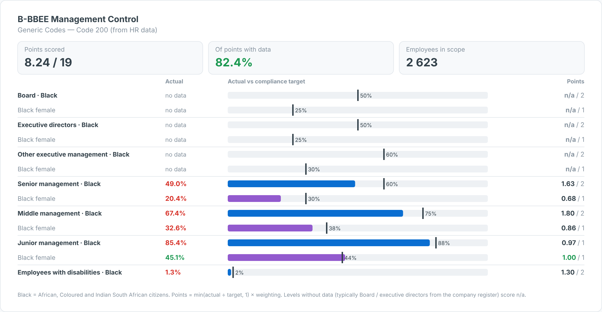

# B-BBEE Management Control — SAC Custom Widget (v0.1.0)

The **B-BBEE Management Control** scorecard (Generic Codes, Code 200) from HR data: black and
black-female representation per management level against the compliance targets, **points per indicator**
(pro-rata, capped at the weighting) and the **total out of 19**, plus black employees with disabilities.

Area: **HR** · Self-contained SVG, no CDN · Currency switch ZAR / USD where amounts are shown.

## Files

| File | Purpose |
|------|---------|
| `bbbeeManagementControl.json` | Manifest — upload as the **JSON** in SAC. |
| `bbbeeManagementControl.zip` | JS bundle — upload as the **ZIP** in SAC. |
| `bbbeeManagementControl.js` | Main web component (renderer inlined). |
| `bbbeeManagementControlStyling.js` | Builder panel. |
| `renderer.core.js` | Canonical renderer, shared with the preview. |
| `preview.html` | Sandbox with synthetic data + controls (open locally in a browser). |

## Data model

- **Dimensions (in order):** 1 B-BBEE management level (Senior / Middle / Junior management …), 2 Race,
  3 Gender, 4 Nationality (optional). Bind *all* employees so the disability indicator uses total headcount.
- **Measures (in order):** 1 Headcount, 2 Headcount with disability (optional).
- *Black* = African, Coloured and Indian South African citizens (foreign nationals excluded).
- Board and executive-director indicators normally come from the company register, not HR; if they aren't
  in the model they show *n/a* and are excluded from the % of points with data.

Default targets/weightings (Generic Codes): Board 50%/25% (2+1), Executive directors 50%/25% (2+1),
Other executive management 60%/30% (2+1), Senior 60%/30% (2+1), Middle 75%/38% (2+1), Junior 88%/44% (1+1),
black employees with disabilities 2% (2). All are editable in `indicators` — use your sector code's values
where one applies.

Hierarchy result/total nodes (`isTotal`) are skipped so they are not double-counted.

## Deploy (JSON + ZIP)

**Administration → App Integration → Custom Widgets → Add**, upload `bbbeeManagementControl.json` (JSON slot) and
`bbbeeManagementControl.zip` (ZIP slot), then insert the widget and bind the feeds in the Builder. `supportsExport` is `true`.

## Key properties

| Property | Default | Notes |
|----------|---------|-------|
| `title` / `subtitle` | | Labels. |
| `indicators` | Generic Codes defaults | `Level:blackPts:target%:femalePts:target%,…` |
| `disabledPoints / disabledTarget` | 2 / 2 | Black employees with disabilities. |
| `showNotAvailable` | true | Show levels without data as n/a. |
| colour properties | | All exposed in the Styling panel. |

Sample data in `preview.html` and `Example.png` is synthetic.

> **Compliance note:** targets and weightings default to the Generic Codes and EEA2 layout as published. Confirm the applicable sector code, sectoral targets and your verification agency's interpretation; this widget is a reporting aid, not a verified scorecard.

## Licence

Proprietary. Copyright © 2026 The Data Co (Pty) Ltd. All rights reserved. This widget may be installed
and used only under a written licence or services agreement with The Data Co; copying, modification and
redistribution are prohibited. See the repository [LICENSE](../../../LICENSE).
