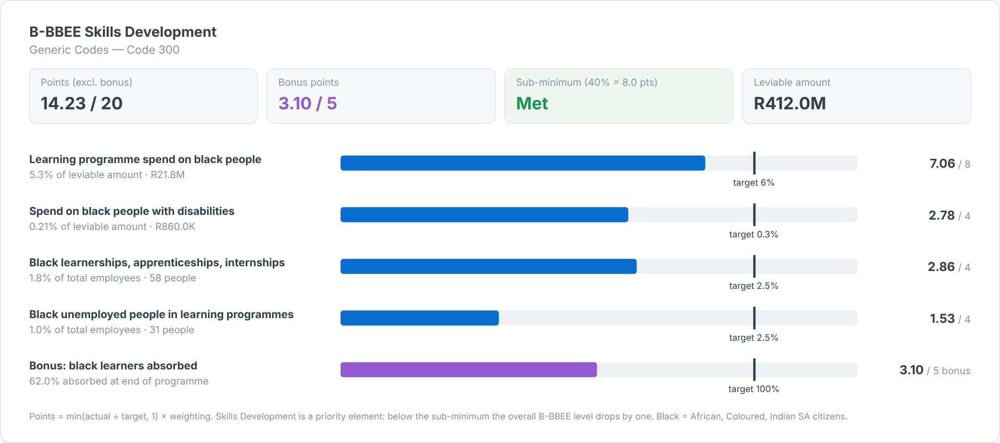

# B-BBEE Skills Development — SAC Custom Widget (v0.1.0)

The **B-BBEE Skills Development** scorecard (Generic Codes, Code 300): learning-programme spend on black
people and on black people with disabilities as % of the **leviable amount**, black learners and black
unemployed learners as % of headcount, the **absorption bonus**, and the **40% sub-minimum** check (a priority
element — missing it discounts the overall level by one).

Area: **HR** · Self-contained SVG, no CDN · Currency switch ZAR / USD where amounts are shown.

## Files

| File | Purpose |
|------|---------|
| `bbbeeSkillsDevelopment.json` | Manifest — upload as the **JSON** in SAC. |
| `bbbeeSkillsDevelopment.zip` | JS bundle — upload as the **ZIP** in SAC. |
| `bbbeeSkillsDevelopment.js` | Main web component (renderer inlined). |
| `bbbeeSkillsDevelopmentStyling.js` | Builder panel. |
| `renderer.core.js` | Canonical renderer, shared with the preview. |
| `preview.html` | Sandbox with synthetic data + controls (open locally in a browser). |

## Data model

- **Dimension:** optional (e.g. legal entity); values are summed.
- **Measures (in order):** 1 Leviable amount (payroll), 2 Learning-programme spend on black people,
  3 Spend on black people with disabilities, 4 Black learners (learnerships / apprenticeships / internships),
  5 Black unemployed people in learning programmes, 6 Total employees, 7 Absorption % (optional).
- Spend typically comes from SuccessFactors Learning / training cost records and payroll; learners from
  employee/learner records.

Default weightings/targets (Generic Codes): spend on black people 8 pts / 6%, disabled 4 pts / 0.3%,
learners 4 pts / 2.5%, unemployed learners 4 pts / 2.5%, absorption bonus 5 pts / 100%, sub-minimum 40%.
All are editable for sector codes or amendments.

Hierarchy result/total nodes (`isTotal`) are skipped so they are not double-counted.

## Deploy (JSON + ZIP)

**Administration → App Integration → Custom Widgets → Add**, upload `bbbeeSkillsDevelopment.json` (JSON slot) and
`bbbeeSkillsDevelopment.zip` (ZIP slot), then insert the widget and bind the feeds in the Builder. `supportsExport` is `true`.

## Key properties

| Property | Default | Notes |
|----------|---------|-------|
| `title` / `subtitle` | | Labels. |
| `pts1…pts4 / tgt1…tgt4` | 8/6, 4/0.3, 4/2.5, 4/2.5 | Indicator weightings and targets. |
| `bonusPts / bonusTgt` | 5 / 100 | Absorption bonus. |
| `subMinimum` | 40 | % of element points. |
| `currency` | ZAR | `ZAR` (R), `USD` ($) or `custom`. |
| colour properties | | All exposed in the Styling panel. |

Sample data in `preview.html` and `Example.png` is synthetic.

> **Compliance note:** targets and weightings default to the Generic Codes and EEA2 layout as published. Confirm the applicable sector code, sectoral targets and your verification agency's interpretation; this widget is a reporting aid, not a verified scorecard.

## Licence

Proprietary. Copyright © 2026 The Data Co (Pty) Ltd. All rights reserved. This widget may be installed
and used only under a written licence or services agreement with The Data Co; copying, modification and
redistribution are prohibited. See the repository [LICENSE](../../../LICENSE).
