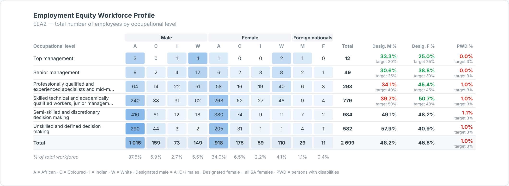

# EE Workforce Profile (EEA2) — SAC Custom Widget (v0.1.0)

The South African **Employment Equity workforce profile** in the statutory **EEA2** layout: employees by
**occupational level** × **Male / Female African, Coloured, Indian, White** and **foreign nationals**, with totals,
% of workforce, and **designated-male %, designated-female %** and **persons-with-disabilities %** per level,
coloured against your sectoral or EE-plan targets.

Area: **HR** · Self-contained SVG, no CDN · Currency switch ZAR / USD where amounts are shown.

## Files

| File | Purpose |
|------|---------|
| `eeWorkforceProfile.json` | Manifest — upload as the **JSON** in SAC. |
| `eeWorkforceProfile.zip` | JS bundle — upload as the **ZIP** in SAC. |
| `eeWorkforceProfile.js` | Main web component (renderer inlined). |
| `eeWorkforceProfileStyling.js` | Builder panel. |
| `renderer.core.js` | Canonical renderer, shared with the preview. |
| `preview.html` | Sandbox with synthetic data + controls (open locally in a browser). |

## Data model

- **Dimensions (in order):** 1 EE occupational level, 2 Race / population group, 3 Gender, 4 Nationality /
  citizenship (optional — members matching `foreignLabels` go to the foreign-national columns).
- **Measures (in order):** 1 Headcount, 2 Headcount with disability (optional — adds the PWD % column).
- Race and gender members are matched by name (African/Coloured/Indian/White, Male/Female), so SAP codes
  need text labels. Levels are ordered by `levelOrder` (partial-name match).
- Use story filters for the different EEA2 tables: permanent vs temporary, and recruitment, promotion,
  termination or training movements on the same widget.

**Typical SAP sources:** SuccessFactors Employee Central (South Africa localisation: ethnic group,
challenge status, EE occupational level on job classification) or SAP HCM ZA (personal data incl.
racial origin, challenge infotype, EE occupational level/category via job), usually staged through a
BW/Datasphere HR model.

Hierarchy result/total nodes (`isTotal`) are skipped so they are not double-counted.

## Deploy (JSON + ZIP)

**Administration → App Integration → Custom Widgets → Add**, upload `eeWorkforceProfile.json` (JSON slot) and
`eeWorkforceProfile.zip` (ZIP slot), then insert the widget and bind the feeds in the Builder. `supportsExport` is `true`.

## Key properties

| Property | Default | Notes |
|----------|---------|-------|
| `title` / `subtitle` | | Labels. |
| `levelOrder` | 6 EEA2 levels | Row order (partial match on member names). |
| `targets` | (blank) | e.g. `Top management:20/25,Senior management:25/30` (designated male % / female %). |
| `disabilityTarget` | 3 | % persons with disabilities. |
| `foreignLabels` | Foreign national, Foreign, Non-SA … | Members treated as foreign nationals. |
| colour properties | | All exposed in the Styling panel. |

Sample data in `preview.html` and `Example.png` is synthetic.

> **Compliance note:** targets and weightings default to the Generic Codes and EEA2 layout as published. Confirm the applicable sector code, sectoral targets and your verification agency's interpretation; this widget is a reporting aid, not a verified scorecard.

## Licence

Proprietary. Copyright © 2026 The Data Co (Pty) Ltd. All rights reserved. This widget may be installed
and used only under a written licence or services agreement with The Data Co; copying, modification and
redistribution are prohibited. See the repository [LICENSE](../../../LICENSE).
