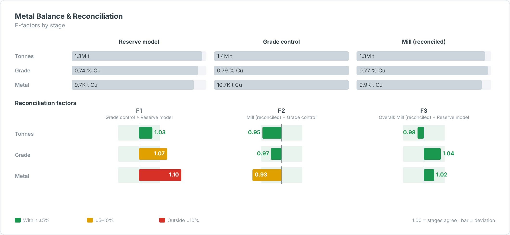

# Metal Balance & Reconciliation — SAC Custom Widget (v0.1.0)

**Metal balance and reconciliation** across stages, e.g. Reserve model → Grade control →
Mill (reconciled). The top section compares tonnes, grade and metal by stage; the bottom is an
**F-factor matrix** (each stage ÷ previous stage, plus overall last ÷ first) for tonnes, grade
and metal, coloured against reconciliation tolerances. With three stages this gives the standard
**F1, F2, F3 (= F1 × F2)**.

Part of the Data Co **mining pack** (Mine-to-Mill Sankey, Grade-Tonnage Curve, Recovery vs Head
Grade, Metal Balance, OEE Time Usage, Fleet Status Timeline, Cost Curve, Safety Pyramid).
Self-contained SVG, no CDN. Units default to copper (t, % Cu, US$/lb); change them in the Styling panel.

## Files

| File | Purpose |
|------|---------|
| `metalBalance.json` | Manifest — upload as the **JSON** in SAC. |
| `metalBalance.zip` | JS bundle — upload as the **ZIP** in SAC. |
| `metalBalance.js` | Main web component (renderer inlined). |
| `metalBalanceStyling.js` | Builder panel. |
| `renderer.core.js` | Canonical renderer, shared with the preview. |
| `preview.html` | Sandbox with synthetic data + controls (open locally in a browser). |

## Data model

- **Dimension:** Stage. Set `stageOrder` (comma list) to force the order, otherwise data order is used.
- **Measures (in order):** 1 = Tonnes, 2 = Grade, 3 = Metal (optional; otherwise t × grade × `metalFactor`).

## Deploy (JSON + ZIP)

**Administration → App Integration → Custom Widgets → Add**, upload `metalBalance.json` (JSON slot)
and `metalBalance.zip` (ZIP slot), then insert the widget and bind the feeds in the Builder.
`supportsExport` is `true`.

## Key properties

| Property | Default | Notes |
|----------|---------|-------|
| `title` / `subtitle` | | Labels. |
| `stageOrder` | (blank) | e.g. `Reserve model, Grade control, Mill`. |
| `tolerance / warnTolerance` | 5 / 10 | Green within ±5 %, amber within ±10 %, red outside. |
| `showOverall` | true | Adds the last ÷ first factor. |
| `metalFactor / metalUnit` | 0.01 / t Cu | Metal derivation. |
| colour properties | | All exposed in the Styling panel. |

Sample data in `preview.html` and `Example.png` is synthetic.
