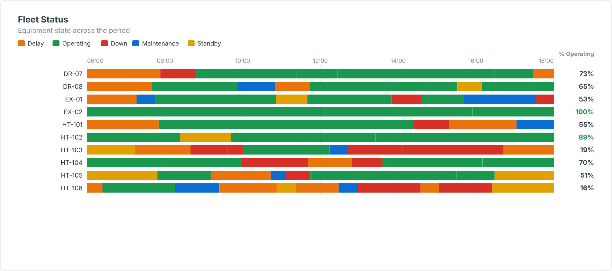

# Fleet Status Timeline — SAC Custom Widget (v0.1.0)

A **fleet state timeline**: one lane per truck, shovel, drill or loader, with coloured
segments for each status (Operating, Standby, Delay, Down, Maintenance…) across the shift or
day, and a **% time operating** column.

Part of the Data Co **mining pack** (Mine-to-Mill Sankey, Grade-Tonnage Curve, Recovery vs Head
Grade, Metal Balance, OEE Time Usage, Fleet Status Timeline, Cost Curve, Safety Pyramid).
Self-contained SVG, no CDN. Units default to copper (t, % Cu, US$/lb); change them in the Styling panel.

## Files

| File | Purpose |
|------|---------|
| `fleetStatusTimeline.json` | Manifest — upload as the **JSON** in SAC. |
| `fleetStatusTimeline.zip` | JS bundle — upload as the **ZIP** in SAC. |
| `fleetStatusTimeline.js` | Main web component (renderer inlined). |
| `fleetStatusTimelineStyling.js` | Builder panel. |
| `renderer.core.js` | Canonical renderer, shared with the preview. |
| `preview.html` | Sandbox with synthetic data + controls (open locally in a browser). |

## Data model

Named feeds (assign each in the Builder):

| Feed | Content |
|---|---|
| Equipment | unit ID |
| Status | state name |
| Start timestamp | `YYYY-MM-DDTHH:MM[:SS]`, `YYYYMMDDHHMMSS`, or a parseable date-time |
| End timestamp | same formats |
| Group (optional) | fleet / equipment class, used by `sortBy = group` |

Timestamps are shown as wall-clock time (no time-zone shift).

## Deploy (JSON + ZIP)

**Administration → App Integration → Custom Widgets → Add**, upload `fleetStatusTimeline.json` (JSON slot)
and `fleetStatusTimeline.zip` (ZIP slot), then insert the widget and bind the feeds in the Builder.
`supportsExport` is `true`.

## Key properties

| Property | Default | Notes |
|----------|---------|-------|
| `title` / `subtitle` | | Labels. |
| `statusColors` | Operating:#1A9850,… | `Name:#hex` pairs; unknown statuses get palette colours. |
| `operatingStatus` | Operating | Status counted in the % column. |
| `sortBy` | name | `name`, `utilisation`, `group`. |
| colour properties | | All exposed in the Styling panel. |

Sample data in `preview.html` and `Example.png` is synthetic.

## Licence

Proprietary. Copyright © 2026 The Data Co (Pty) Ltd. All rights reserved. This widget may be installed
and used only under a written licence or services agreement with The Data Co; copying, modification and
redistribution are prohibited. See the repository [LICENSE](../../../LICENSE).
