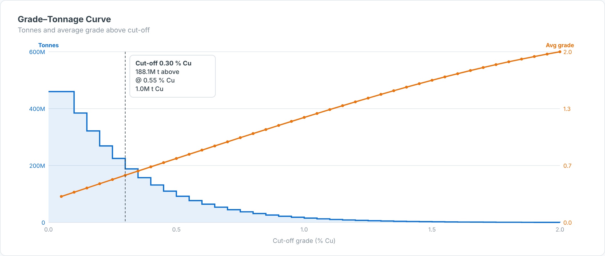

# Grade-Tonnage Curve — SAC Custom Widget (v0.1.0)

The classic **grade–tonnage curve** from block-model grade classes: **tonnes above cut-off**
(left axis, stepped area) and **average grade above cut-off** (right axis), with a cut-off
read-out of tonnes, grade and contained metal.

Part of the Data Co **mining pack** (Mine-to-Mill Sankey, Grade-Tonnage Curve, Recovery vs Head
Grade, Metal Balance, OEE Time Usage, Fleet Status Timeline, Cost Curve, Safety Pyramid).
Self-contained SVG, no CDN. Units default to copper (t, % Cu, US$/lb); change them in the Styling panel.

## Files

| File | Purpose |
|------|---------|
| `gradeTonnageCurve.json` | Manifest — upload as the **JSON** in SAC. |
| `gradeTonnageCurve.zip` | JS bundle — upload as the **ZIP** in SAC. |
| `gradeTonnageCurve.js` | Main web component (renderer inlined). |
| `gradeTonnageCurveStyling.js` | Builder panel. |
| `renderer.core.js` | Canonical renderer, shared with the preview. |
| `preview.html` | Sandbox with synthetic data + controls (open locally in a browser). |

## Data model

- **Dimension:** grade bin / class. If no grade measure is bound, the bin grade is parsed from the
  member label (e.g. `0.30`, `0.30 %`).
- **Measures (in order):** 1 = Tonnes, 2 = Bin grade (optional).

## Deploy (JSON + ZIP)

**Administration → App Integration → Custom Widgets → Add**, upload `gradeTonnageCurve.json` (JSON slot)
and `gradeTonnageCurve.zip` (ZIP slot), then insert the widget and bind the feeds in the Builder.
`supportsExport` is `true`.

## Key properties

| Property | Default | Notes |
|----------|---------|-------|
| `title` / `subtitle` | | Labels. |
| `cutoff` | 0.3 | Highlighted cut-off grade. |
| `metalFactor / metalUnit` | 0.01 / t Cu | Metal = t × grade × factor. For g/t → oz use 0.0321507. |
| `showMetal / showArea` | true | Toggles. |
| colour properties | | All exposed in the Styling panel. |

Sample data in `preview.html` and `Example.png` is synthetic.

## Licence

Proprietary. Copyright © 2026 The Data Co (Pty) Ltd. All rights reserved. This widget may be installed
and used only under a written licence or services agreement with The Data Co; copying, modification and
redistribution are prohibited. See the repository [LICENSE](../../../LICENSE).
