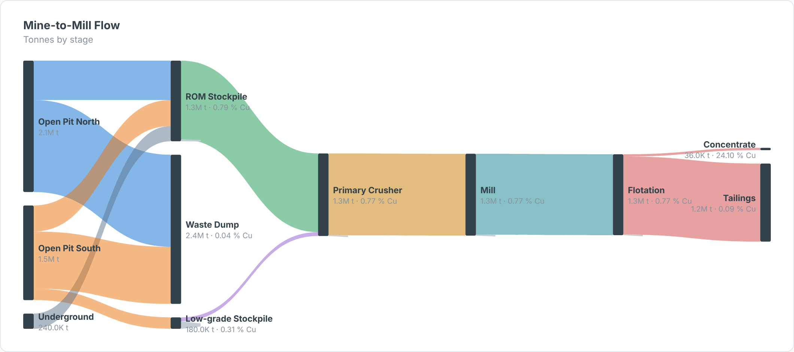

# Mine-to-Mill Sankey — SAC Custom Widget (v0.1.0)

A **material-flow Sankey** for mining: pits and stopes → stockpiles → crusher → mill →
flotation → concentrate and tailings. Link width is tonnes; links can be coloured by source
or by **grade**; node labels show tonnes and tonnes-weighted grade. Where a node passes on
less than it receives (losses, stockpile build), a small grey stub marks the difference.

Part of the Data Co **mining pack** (Mine-to-Mill Sankey, Grade-Tonnage Curve, Recovery vs Head
Grade, Metal Balance, OEE Time Usage, Fleet Status Timeline, Cost Curve, Safety Pyramid).
Self-contained SVG, no CDN. Units default to copper (t, % Cu, US$/lb); change them in the Styling panel.

## Files

| File | Purpose |
|------|---------|
| `mineToMillSankey.json` | Manifest — upload as the **JSON** in SAC. |
| `mineToMillSankey.zip` | JS bundle — upload as the **ZIP** in SAC. |
| `mineToMillSankey.js` | Main web component (renderer inlined). |
| `mineToMillSankeyStyling.js` | Builder panel. |
| `renderer.core.js` | Canonical renderer, shared with the preview. |
| `preview.html` | Sandbox with synthetic data + controls (open locally in a browser). |

## Data model

- **Dimensions (in order):** 1 = Source node, 2 = Target node (one row per flow).
- **Measures (in order):** 1 = Tonnes, 2 = Grade (optional; tonnes-weighted when aggregated).

Columns are worked out from the flow graph (longest path from a source), so the stage order needs
no configuration.

## Deploy (JSON + ZIP)

**Administration → App Integration → Custom Widgets → Add**, upload `mineToMillSankey.json` (JSON slot)
and `mineToMillSankey.zip` (ZIP slot), then insert the widget and bind the feeds in the Builder.
`supportsExport` is `true`.

## Key properties

| Property | Default | Notes |
|----------|---------|-------|
| `title` / `subtitle` | | Labels. |
| `colorBy` | source | `source` or `grade` (diverging low → high). |
| `showLosses` | true | Inflow − outflow stub per node. |
| `gradeUnit / gradeDecimals` | % Cu / 2 | Use `g/t Au` etc. for precious metals. |
| `suffix` | " t" | Tonnes unit label. |
| colour properties | | All exposed in the Styling panel. |

Sample data in `preview.html` and `Example.png` is synthetic.

## Licence

Proprietary. Copyright © 2026 The Data Co (Pty) Ltd. All rights reserved. This widget may be installed
and used only under a written licence or services agreement with The Data Co; copying, modification and
redistribution are prohibited. See the repository [LICENSE](../../../LICENSE).
