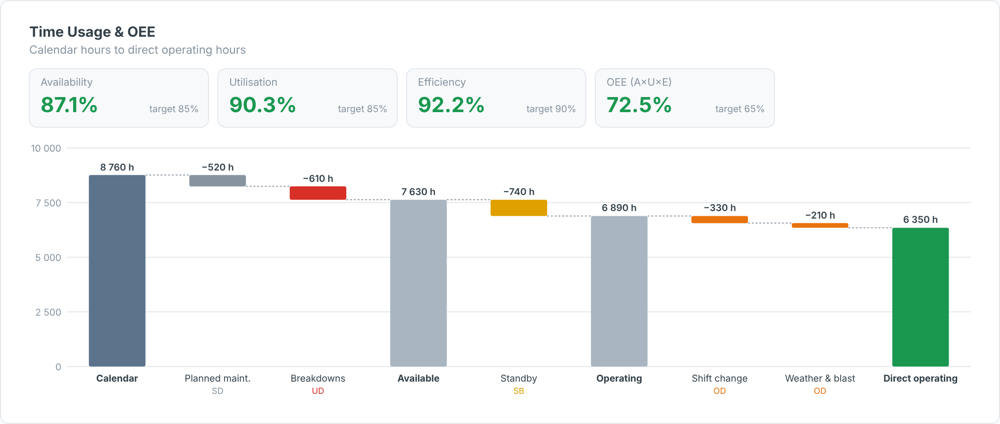

# OEE Time-Usage Waterfall — SAC Custom Widget (v0.1.0)

A **time-usage waterfall** (calendar hours → direct operating hours) using the usual
mining time model, with **Availability, Utilisation, Efficiency and OEE (= A × U × E)** tiles
against targets. Subtotal bars show Available and Operating hours.

Part of the Data Co **mining pack** (Mine-to-Mill Sankey, Grade-Tonnage Curve, Recovery vs Head
Grade, Metal Balance, OEE Time Usage, Fleet Status Timeline, Cost Curve, Safety Pyramid).
Self-contained SVG, no CDN. Units default to copper (t, % Cu, US$/lb); change them in the Styling panel.

## Files

| File | Purpose |
|------|---------|
| `oeeTimeUsage.json` | Manifest — upload as the **JSON** in SAC. |
| `oeeTimeUsage.zip` | JS bundle — upload as the **ZIP** in SAC. |
| `oeeTimeUsage.js` | Main web component (renderer inlined). |
| `oeeTimeUsageStyling.js` | Builder panel. |
| `renderer.core.js` | Canonical renderer, shared with the preview. |
| `preview.html` | Sandbox with synthetic data + controls (open locally in a browser). |

## Data model

- **Dimension (optional):** equipment or fleet. Values are summed, so filter the story to drill in.
- **Measures (in order):** 1 = Calendar hours, then loss hours. Tag each loss with `lossTypes`
  (default `SD,UD,SB,OD`):
  - `SD` scheduled down, `UD` unscheduled down → Availability = (Cal − SD − UD) / Cal
  - `SB` standby → Utilisation = Operating / Available
  - `OD` operating delay, `PL` performance loss (hours equivalent) → Efficiency = Direct / Operating

## Deploy (JSON + ZIP)

**Administration → App Integration → Custom Widgets → Add**, upload `oeeTimeUsage.json` (JSON slot)
and `oeeTimeUsage.zip` (ZIP slot), then insert the widget and bind the feeds in the Builder.
`supportsExport` is `true`.

## Key properties

| Property | Default | Notes |
|----------|---------|-------|
| `title` / `subtitle` | | Labels. |
| `lossTypes` | SD,UD,SB,OD | Category per loss measure, in binding order. |
| `availTarget / utilTarget / effTarget / oeeTarget` | 85 / 85 / 90 / 65 | Tile colouring. |
| `showSubtotals / showKpis` | true | Toggles. |
| colour properties | | All exposed in the Styling panel. |

Sample data in `preview.html` and `Example.png` is synthetic.
