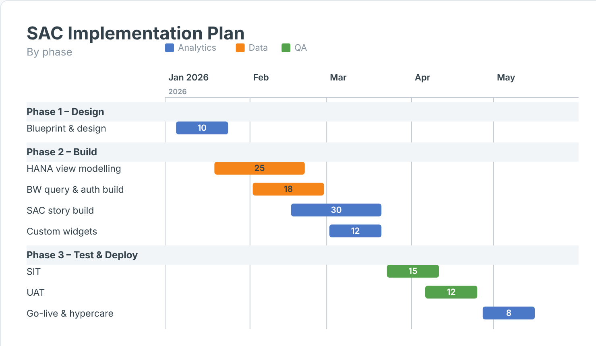

## SAP Analytics Cloud Content

This directory contains artifacts created for SAP Analytics Cloud.

**Proprietary — © 2026 The Data Co (Pty) Ltd. All rights reserved.** Use requires a written licence; see [LICENSE](../LICENSE). 

Currently available. 

1. Calendar Heatmap

2. Flow Diagram

3. Variance KPI Tile

4. Variance Bridge

5. Bullet Chart

6. Variance Heatmap

7. Gantt Chart

8. Mine-to-Mill Sankey

9. Grade-Tonnage Curve

10. Recovery vs Head Grade

11. Metal Balance

12. OEE Time Usage

13. Fleet Status Timeline

14. Cost Curve

15. Safety Pyramid

