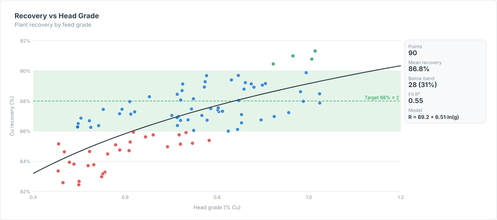

# Recovery vs Head Grade — SAC Custom Widget (v0.1.0)

A **plant performance scatter**: recovery against head (feed) grade per day or shift, with a
**log or linear fit**, R², the fitted model, a **target band** and the share of points below it.
It helps separate ore-driven misses (low grade) from plant-driven misses (low recovery at normal grade).

Part of the Data Co **mining pack** (Mine-to-Mill Sankey, Grade-Tonnage Curve, Recovery vs Head
Grade, Metal Balance, OEE Time Usage, Fleet Status Timeline, Cost Curve, Safety Pyramid).
Self-contained SVG, no CDN. Units default to copper (t, % Cu, US$/lb); change them in the Styling panel.

## Files

| File | Purpose |
|------|---------|
| `recoveryHeadGrade.json` | Manifest — upload as the **JSON** in SAC. |
| `recoveryHeadGrade.zip` | JS bundle — upload as the **ZIP** in SAC. |
| `recoveryHeadGrade.js` | Main web component (renderer inlined). |
| `recoveryHeadGradeStyling.js` | Builder panel. |
| `renderer.core.js` | Canonical renderer, shared with the preview. |
| `preview.html` | Sandbox with synthetic data + controls (open locally in a browser). |

## Data model

- **Dimensions (in order):** 1 = Point (day/shift), 2 = Group (optional, e.g. ore type or month).
- **Measures (in order):** 1 = Head grade, 2 = Recovery (percent or fraction — auto-detected).

## Deploy (JSON + ZIP)

**Administration → App Integration → Custom Widgets → Add**, upload `recoveryHeadGrade.json` (JSON slot)
and `recoveryHeadGrade.zip` (ZIP slot), then insert the widget and bind the feeds in the Builder.
`supportsExport` is `true`.

## Key properties

| Property | Default | Notes |
|----------|---------|-------|
| `title` / `subtitle` | | Labels. |
| `fitType` | log | `log`, `linear`, `none`. |
| `targetRecovery / targetBand` | 88 / 2 | Band = target ± band (%). |
| `colorBy` | band | `band` (below / in / above) or `group`. |
| `recoveryScale` | auto | `auto`, `percent`, `fraction`. |
| colour properties | | All exposed in the Styling panel. |

Sample data in `preview.html` and `Example.png` is synthetic.

## Licence

Proprietary. Copyright © 2026 The Data Co (Pty) Ltd. All rights reserved. This widget may be installed
and used only under a written licence or services agreement with The Data Co; copying, modification and
redistribution are prohibited. See the repository [LICENSE](../../LICENSE).
