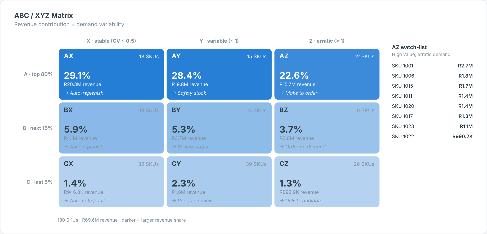

# ABC/XYZ Matrix — SAC Custom Widget (v0.1.0)

An **ABC / XYZ matrix**: SKUs classified by **revenue contribution** (A = top 80 %, B = next 15 %,
C = last 5 % cumulative) and **demand variability** (X/Y/Z by coefficient of variation across periods)
into a 3×3 grid with SKU count, revenue share, a stock-policy hint per cell and an **AZ watch-list**.

Area: **Retail** · Self-contained SVG, no CDN · Currency switch ZAR / USD where amounts are shown.

## Files

| File | Purpose |
|------|---------|
| `abcXyzMatrix.json` | Manifest — upload as the **JSON** in SAC. |
| `abcXyzMatrix.zip` | JS bundle — upload as the **ZIP** in SAC. |
| `abcXyzMatrix.js` | Main web component (renderer inlined). |
| `abcXyzMatrixStyling.js` | Builder panel. |
| `renderer.core.js` | Canonical renderer, shared with the preview. |
| `preview.html` | Sandbox with synthetic data + controls (open locally in a browser). |

## Data model

- **Dimensions (in order):** 1 SKU / article, 2 Period (week or month). Variability is the coefficient of
  variation across periods (missing periods count as zero).
- **Measures (in order):** 1 Revenue, 2 Demand units (optional — otherwise revenue is used for variability).

Hierarchy result/total nodes (`isTotal`) are skipped so they are not double-counted.

## Deploy (JSON + ZIP)

**Administration → App Integration → Custom Widgets → Add**, upload `abcXyzMatrix.json` (JSON slot) and
`abcXyzMatrix.zip` (ZIP slot), then insert the widget and bind the feeds in the Builder. `supportsExport` is `true`.

## Key properties

| Property | Default | Notes |
|----------|---------|-------|
| `title` / `subtitle` | | Labels. |
| `aCut / bCut` | 80 / 95 | Cumulative revenue % boundaries. |
| `xCut / yCut` | 0.5 / 1.0 | CV boundaries. |
| `actions` | 9 policies AX…CZ | Comma list shown in each cell. |
| `currency` | ZAR | `ZAR` (R), `USD` ($) or `custom`. |
| colour properties | | All exposed in the Styling panel. |

Sample data in `preview.html` and `Example.png` is synthetic.

## Licence

Proprietary. Copyright © 2026 The Data Co (Pty) Ltd. All rights reserved. This widget may be installed
and used only under a written licence or services agreement with The Data Co; copying, modification and
redistribution are prohibited. See the repository [LICENSE](../../../LICENSE).
