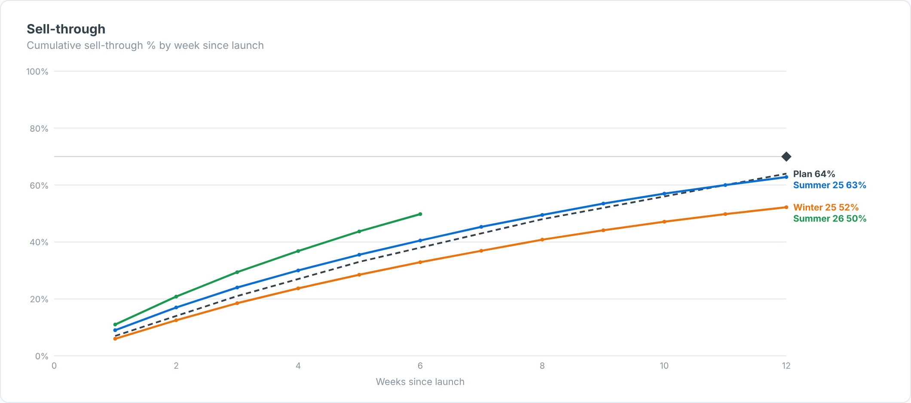

# Sell-through Curve — SAC Custom Widget (v0.1.0)

**Season sell-through**: cumulative sell-through % (units sold ÷ units bought) by week since launch,
one line per season or collection, against a **planned curve** and an end-of-life target marker.

Area: **Retail** · Self-contained SVG, no CDN · Currency switch ZAR / USD where amounts are shown.

## Files

| File | Purpose |
|------|---------|
| `sellThroughCurve.json` | Manifest — upload as the **JSON** in SAC. |
| `sellThroughCurve.zip` | JS bundle — upload as the **ZIP** in SAC. |
| `sellThroughCurve.js` | Main web component (renderer inlined). |
| `sellThroughCurveStyling.js` | Builder panel. |
| `renderer.core.js` | Canonical renderer, shared with the preview. |
| `preview.html` | Sandbox with synthetic data + controls (open locally in a browser). |

## Data model

- **Dimensions (in order):** 1 Season / collection, 2 Week since launch (numeric; labels like `Wk 3` work).
- **Measures (in order):** 1 Units sold (weekly), 2 Units bought (receipts; the max per season is used),
  3 Planned cumulative sell-through % (optional — or set `planCurve`).

Hierarchy result/total nodes (`isTotal`) are skipped so they are not double-counted.

## Deploy (JSON + ZIP)

**Administration → App Integration → Custom Widgets → Add**, upload `sellThroughCurve.json` (JSON slot) and
`sellThroughCurve.zip` (ZIP slot), then insert the widget and bind the feeds in the Builder. `supportsExport` is `true`.

## Key properties

| Property | Default | Notes |
|----------|---------|-------|
| `title` / `subtitle` | | Labels. |
| `planCurve` | (blank) | Comma list of planned cumulative % by week. |
| `targetST / targetWeek` | 70 / 0 | Target marker (0 = last week). |
| `showEndLabels` | true | Series end labels. |
| colour properties | | All exposed in the Styling panel. |

Sample data in `preview.html` and `Example.png` is synthetic.

## Licence

Proprietary. Copyright © 2026 The Data Co (Pty) Ltd. All rights reserved. This widget may be installed
and used only under a written licence or services agreement with The Data Co; copying, modification and
redistribution are prohibited. See the repository [LICENSE](../../../LICENSE).
