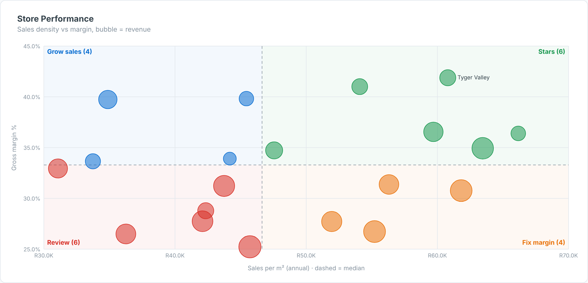

# Store Performance Quadrant — SAC Custom Widget (v0.1.0)

A **store performance quadrant**: each store is a bubble on two KPIs (default sales per m² vs gross
margin %), split by **medians or targets** into four labelled quadrants (*Stars, Grow sales, Fix margin,
Review*) with counts; bubble size is revenue.

Area: **Retail** · Self-contained SVG, no CDN · Currency switch ZAR / USD where amounts are shown.

## Files

| File | Purpose |
|------|---------|
| `storeQuadrant.json` | Manifest — upload as the **JSON** in SAC. |
| `storeQuadrant.zip` | JS bundle — upload as the **ZIP** in SAC. |
| `storeQuadrant.js` | Main web component (renderer inlined). |
| `storeQuadrantStyling.js` | Builder panel. |
| `renderer.core.js` | Canonical renderer, shared with the preview. |
| `preview.html` | Sandbox with synthetic data + controls (open locally in a browser). |

## Data model

- **Dimensions (in order):** 1 Store, 2 Region / format (optional).
- **Measures (in order):** 1 X KPI, 2 Y KPI, 3 Bubble size (optional).
- Percent KPIs can be fractions (0.32) or percentages (32); fractions are detected automatically.

Hierarchy result/total nodes (`isTotal`) are skipped so they are not double-counted.

## Deploy (JSON + ZIP)

**Administration → App Integration → Custom Widgets → Add**, upload `storeQuadrant.json` (JSON slot) and
`storeQuadrant.zip` (ZIP slot), then insert the widget and bind the feeds in the Builder. `supportsExport` is `true`.

## Key properties

| Property | Default | Notes |
|----------|---------|-------|
| `title` / `subtitle` | | Labels. |
| `splitMode` | median | `median` or `target` (`xTarget`, `yTarget`). |
| `quadrantLabels` | Stars,Grow sales,Fix margin,Review | TR, TL, BR, BL. |
| `xFormat / yFormat` | currency / pct | `currency`, `pct`, `number`. |
| `labelMode` | outliers | `outliers`, `all`, `none`. |
| `currency` | ZAR | `ZAR` (R), `USD` ($) or `custom`. |
| colour properties | | All exposed in the Styling panel. |

Sample data in `preview.html` and `Example.png` is synthetic.

## Licence

Proprietary. Copyright © 2026 The Data Co (Pty) Ltd. All rights reserved. This widget may be installed
and used only under a written licence or services agreement with The Data Co; copying, modification and
redistribution are prohibited. See the repository [LICENSE](../../../LICENSE).
