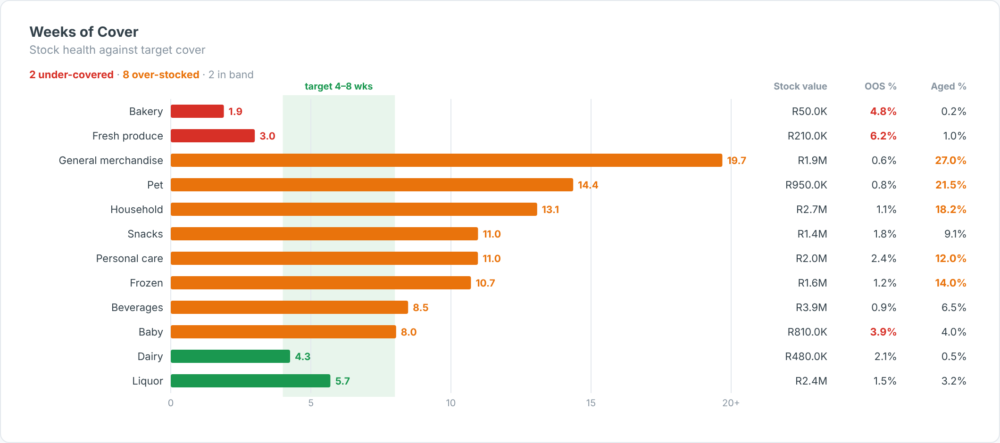

# Weeks of Cover — SAC Custom Widget (v0.1.0)

A **stock-health view**: weeks of cover (stock ÷ average weekly sales) per category or store against a
**target band**, coloured under-covered / in band / over-stocked, with stock value, out-of-stock % and
aged-stock % columns flagged against thresholds.

Area: **Retail** · Self-contained SVG, no CDN · Currency switch ZAR / USD where amounts are shown.

## Files

| File | Purpose |
|------|---------|
| `weeksOfCover.json` | Manifest — upload as the **JSON** in SAC. |
| `weeksOfCover.zip` | JS bundle — upload as the **ZIP** in SAC. |
| `weeksOfCover.js` | Main web component (renderer inlined). |
| `weeksOfCoverStyling.js` | Builder panel. |
| `renderer.core.js` | Canonical renderer, shared with the preview. |
| `preview.html` | Sandbox with synthetic data + controls (open locally in a browser). |

## Data model

- **Dimension:** category / store / department.
- **Measures (in order):** 1 Stock on hand (units), 2 Average weekly sales (units, or forecast), 3 Stock value,
  4 OOS %, 5 Aged stock % (3–5 optional; percentages may be fractions or 0–100).

Hierarchy result/total nodes (`isTotal`) are skipped so they are not double-counted.

## Deploy (JSON + ZIP)

**Administration → App Integration → Custom Widgets → Add**, upload `weeksOfCover.json` (JSON slot) and
`weeksOfCover.zip` (ZIP slot), then insert the widget and bind the feeds in the Builder. `supportsExport` is `true`.

## Key properties

| Property | Default | Notes |
|----------|---------|-------|
| `title` / `subtitle` | | Labels. |
| `minWeeks / maxWeeks` | 4 / 8 | Target band. |
| `capWeeks` | 20 | Axis cap. |
| `sortBy` | risk | `risk`, `cover`, `name`, `value`. |
| `oosTarget / agedTarget` | 3 / 10 | % flags. |
| `currency` | ZAR | `ZAR` (R), `USD` ($) or `custom`. |
| colour properties | | All exposed in the Styling panel. |

Sample data in `preview.html` and `Example.png` is synthetic.

## Licence

Proprietary. Copyright © 2026 The Data Co (Pty) Ltd. All rights reserved. This widget may be installed
and used only under a written licence or services agreement with The Data Co; copying, modification and
redistribution are prohibited. See the repository [LICENSE](../../../LICENSE).
