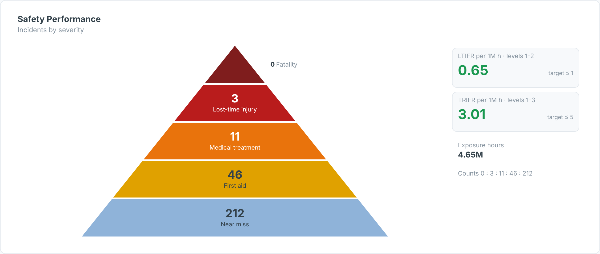

# Safety Pyramid — SAC Custom Widget (v0.1.0)

A **safety triangle**: incident counts by severity (fatality → LTI → medical treatment →
first aid → near miss), with **LTIFR** and **TRIFR** tiles against targets when exposure hours
are bound.

Part of the Data Co **mining pack** (Mine-to-Mill Sankey, Grade-Tonnage Curve, Recovery vs Head
Grade, Metal Balance, OEE Time Usage, Fleet Status Timeline, Cost Curve, Safety Pyramid).
Self-contained SVG, no CDN. Units default to copper (t, % Cu, US$/lb); change them in the Styling panel.

## Files

| File | Purpose |
|------|---------|
| `safetyPyramid.json` | Manifest — upload as the **JSON** in SAC. |
| `safetyPyramid.zip` | JS bundle — upload as the **ZIP** in SAC. |
| `safetyPyramid.js` | Main web component (renderer inlined). |
| `safetyPyramidStyling.js` | Builder panel. |
| `renderer.core.js` | Canonical renderer, shared with the preview. |
| `preview.html` | Sandbox with synthetic data + controls (open locally in a browser). |

## Data model

- **Dimension (optional):** site or period. Values are summed.
- **Measures:** incident counts from **most to least severe**. A measure whose name contains *hours*,
  *hrs* or *exposure* is used as exposure hours rather than a pyramid level.

## Deploy (JSON + ZIP)

**Administration → App Integration → Custom Widgets → Add**, upload `safetyPyramid.json` (JSON slot)
and `safetyPyramid.zip` (ZIP slot), then insert the widget and bind the feeds in the Builder.
`supportsExport` is `true`.

## Key properties

| Property | Default | Notes |
|----------|---------|-------|
| `title` / `subtitle` | | Labels. |
| `rateBase` | 1000000 | Per million hours; use 200000 for OSHA-style rates. |
| `ltiLevels / trifrLevels` | 1-2 / 1-3 | Pyramid levels counted in each rate. |
| `ltifrTarget / trifrTarget` | 1 / 5 | Tile colouring. |
| `showRatio` | true | Ratio line, e.g. 1 : 4 : 15. |
| colour properties | | All exposed in the Styling panel. |

Sample data in `preview.html` and `Example.png` is synthetic.
