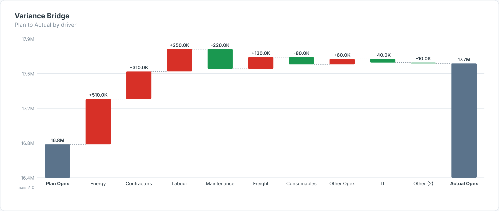

# Variance Bridge — SAC Custom Widget (v0.1.0)

A **Plan → Actual waterfall** for SAP Analytics Cloud. Each driver member (site, cost
element, product…) becomes a floating step of **Actual − Plan**, sorted by impact, with
the tail rolled into **Other (n)**. Favourable steps are green, unfavourable red.

Part of the Data Co **variance pack** (KPI Tile, Variance Bridge, Bullet Chart, Variance
Heatmap). Same conventions across all four: measures are bound **in order** (Actual first),
`invertSign` for cost measures, and shared number formatting. Self-contained SVG, no CDN.

## Files

| File | Purpose |
|------|---------|
| `varianceBridge.json` | Manifest — upload as the **JSON** in SAC. |
| `varianceBridge.zip` | JS bundle — upload as the **ZIP** in SAC. |
| `varianceBridge.js` | Main web component (renderer inlined). |
| `varianceBridgeStyling.js` | Builder panel. |
| `renderer.core.js` | Canonical renderer, shared with the preview. |
| `preview.html` | Sandbox with synthetic data + controls (open locally in a browser). |

## Data model

- **Dimension:** the driver (1 dimension).
- **Measures (in order):** 1 = Actual, 2 = Plan.

Start/end bars are the totals of the bound rows. When everything is positive the value axis
is zoomed (not from zero) so small steps stay readable — flagged with an `axis ≠ 0` note.

Hierarchy result/total nodes (`isTotal`) are skipped so they are not double-counted. For live
BW/HANA models, put variance and YTD logic in the query/view; the widget only does
presentation-level variance.

## Deploy (JSON + ZIP)

**Administration → App Integration → Custom Widgets → Add**, upload `varianceBridge.json` (JSON slot)
and `varianceBridge.zip` (ZIP slot), then insert the widget in a story/application and bind the feeds
in the Builder. `supportsExport` is `true`, so it is included in PDF/PPT export.

## Key properties

| Property | Default | Notes |
|----------|---------|-------|
| `title` / `subtitle` | | Labels. |
| `topN` | 8 | Drivers shown before the rest roll into *Other*. |
| `sortBy` | abs | `abs` (largest impact first) or `none` (data order). |
| `invertSign` | false | Set for cost/opex: overspend = red. |
| `showValues / showConnectors` | true | Toggles. |
| `valueScale / decimals / prefix / suffix` | auto / 1 | Number format. |
| colour properties | | All exposed in the Styling panel. |
