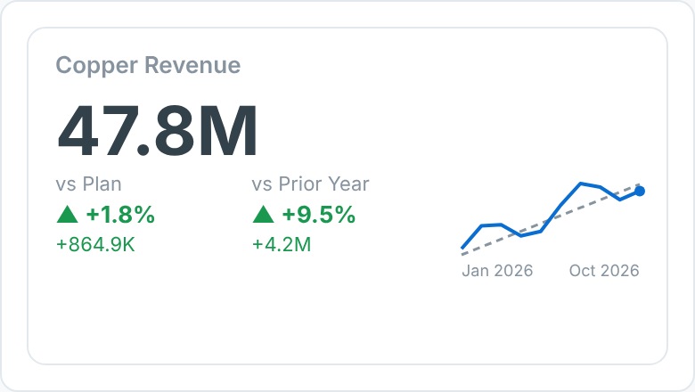

# Variance KPI Tile — SAC Custom Widget (v0.1.0)

A compact KPI card for SAP Analytics Cloud: the headline **Actual** with variance
chips **vs Plan** and **vs Prior Year** (▲/▼, % and absolute), coloured favourable /
unfavourable, plus an optional **Actual-vs-Plan sparkline** when a period dimension is bound.

Part of the Data Co **variance pack** (KPI Tile, Variance Bridge, Bullet Chart, Variance
Heatmap). Same conventions across all four: measures are bound **in order** (Actual first),
`invertSign` for cost measures, and shared number formatting. Self-contained SVG, no CDN.

## Files

| File | Purpose |
|------|---------|
| `varianceKpiTile.json` | Manifest — upload as the **JSON** in SAC. |
| `varianceKpiTile.zip` | JS bundle — upload as the **ZIP** in SAC. |
| `varianceKpiTile.js` | Main web component (renderer inlined). |
| `varianceKpiTileStyling.js` | Builder panel. |
| `renderer.core.js` | Canonical renderer, shared with the preview. |
| `preview.html` | Sandbox with synthetic data + controls (open locally in a browser). |

## Data model

- **Measures (in order):** 1 = Actual, 2 = Plan, 3 = Prior Year. Only Actual is required.
- **Dimension (optional):** a period (month/week). Drives the sparkline; the headline
  collapses periods with `aggregation` = `sum` (flow measures) or `last` (YTD / stock measures).

Hierarchy result/total nodes (`isTotal`) are skipped so they are not double-counted. For live
BW/HANA models, put variance and YTD logic in the query/view; the widget only does
presentation-level variance.

## Deploy (JSON + ZIP)

**Administration → App Integration → Custom Widgets → Add**, upload `varianceKpiTile.json` (JSON slot)
and `varianceKpiTile.zip` (ZIP slot), then insert the widget in a story/application and bind the feeds
in the Builder. `supportsExport` is `true`, so it is included in PDF/PPT export.

## Key properties

| Property | Default | Notes |
|----------|---------|-------|
| `title` / `subtitle` | | Labels. |
| `aggregation` | sum | `sum` or `last` — how periods collapse into the headline. |
| `invertSign` | false | Cost measures: below plan = favourable (green). |
| `showPlan / showPY / showSparkline` | true | Toggles. |
| `valueScale` | auto | `auto`, `none`, `K`, `M`, `B`. |
| `decimals / prefix / suffix` | 1 / – / – | Number format, e.g. prefix `$`. |
| colour properties | | All exposed in the Styling panel. |

## Licence

Proprietary. Copyright © 2026 The Data Co (Pty) Ltd. All rights reserved. This widget may be installed
and used only under a written licence or services agreement with The Data Co; copying, modification and
redistribution are prohibited. See the repository [LICENSE](../../LICENSE).
